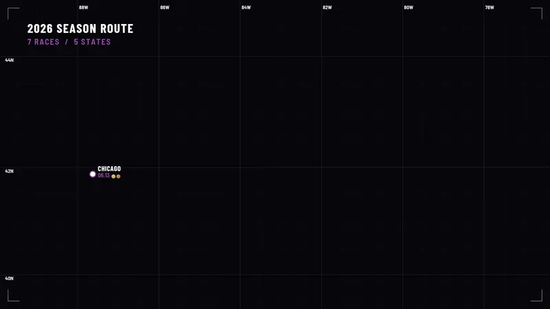
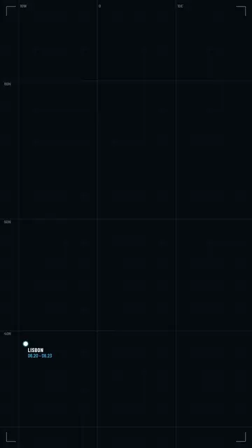
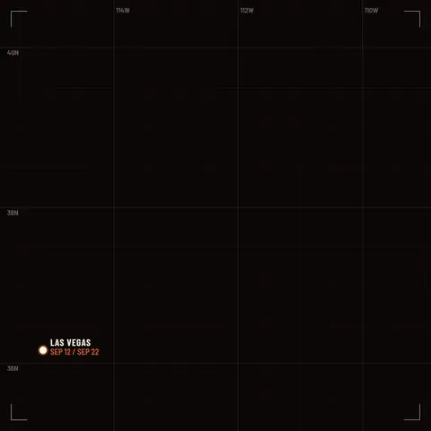
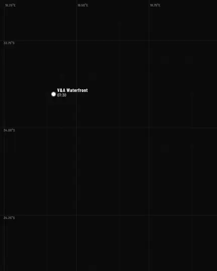
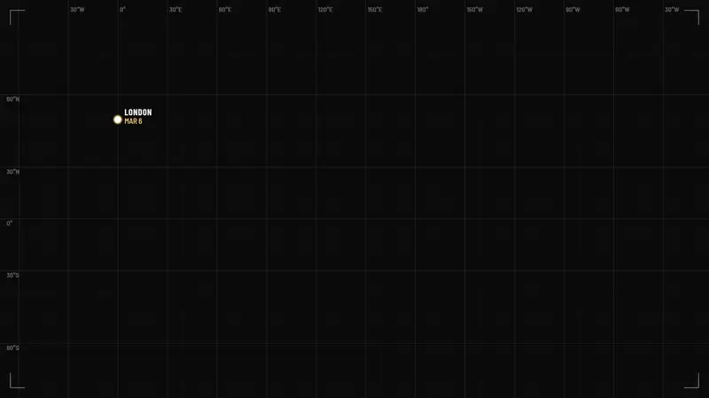

<div align="center">


# Waycine: trip map video maker

**Your journey, in motion.**

Waycine ("way cinema") turns a list of stops into an animated travel map
video of your trip, road trip, tour or race season.<br>
Free and open source. It runs in your browser, and nothing is uploaded.

[](CHANGELOG.md)
[](https://www.npmjs.com/package/waycine)
[](https://github.com/zhenyuanlu/waycine/actions/workflows/ci.yml)
[](LICENSE)
[](CONTRIBUTING.md#setup)
[](tsconfig.base.json)
[](#why-i-built-this)

[](https://zhenyuanlu.com/waycine/)

[Demos](#demos)
&nbsp;·&nbsp; [Features](#features)
&nbsp;·&nbsp; [Library](#use-it-as-a-library)
&nbsp;·&nbsp; [Command line](#command-line)
&nbsp;·&nbsp; [Documentation](#documentation)

<picture>
  <source media="(prefers-reduced-motion: reduce)" srcset="docs/media/waycine-season-poster.png">
  
</picture>

</div>

> **Pre-release.** Version 0.1.0 is being prepared. The web app is online; the
> npm packages `waycine` and `waycine-cli` are not published yet, so until
> they are, run the library and the CLI
> [from source](docs/cli.md#from-source).

## Demos

Five demos ship with Waycine, each a single JSON file in
[`packages/waycine/presets`](packages/waycine/presets). Open one in the app,
change anything, and export your own video.

<div align="center">
<table>
  <tr>
    <td align="center">
      <a href="https://zhenyuanlu.com/waycine/?demo=europe-trip"></a>
    </td>
    <td align="center">
      <a href="https://zhenyuanlu.com/waycine/?demo=road-trip"></a>
    </td>
    <td align="center">
      <a href="https://zhenyuanlu.com/waycine/?demo=day-trip"></a>
    </td>
  </tr>
  <tr>
    <td align="center">
      <b>Europe trip</b> · 9:16<br>
      <sub>A holiday through eight cities.<br>Midnight Cyan, Fly.</sub><br>
      <a href="https://zhenyuanlu.com/waycine/?demo=europe-trip">Open this demo</a>
    </td>
    <td align="center">
      <b>Road trip</b> · 1:1<br>
      <sub>A loop through the parks, in days and miles.<br>Ember theme, Dip to dark transition.</sub><br>
      <a href="https://zhenyuanlu.com/waycine/?demo=road-trip">Open this demo</a>
    </td>
    <td align="center">
      <b>Day trip</b> · 4:5<br>
      <sub>One day in one place, hour by hour.<br>Mono theme, Fly transition.</sub><br>
      <a href="https://zhenyuanlu.com/waycine/?demo=day-trip">Open this demo</a>
    </td>
  </tr>
</table>
</div>

<div align="center">
<table>
  <tr>
    <td align="center">
      <a href="https://zhenyuanlu.com/waycine/?demo=world-tour"></a>
    </td>
    <td align="center">
      <a href="https://zhenyuanlu.com/waycine/?demo=race-season"></a>
    </td>
  </tr>
  <tr>
    <td align="center">
      <b>World tour</b> · 16:9<br>
      <sub>Nine shows around the world, across the Pacific.<br>Your own colours, Flash to colour transition.</sub><br>
      <a href="https://zhenyuanlu.com/waycine/?demo=world-tour">Open this demo</a>
    </td>
    <td align="center">
      <b>Race season</b> · 16:9<br>
      <sub>A team's season with results and medals.<br>Orchid theme, Flash to white transition.</sub><br>
      <a href="https://zhenyuanlu.com/waycine/?demo=race-season">Open this demo</a>
    </td>
  </tr>
</table>
</div>

These are small copies of the real exports; the app renders the same demos up
to 4K.

## Make a video in your browser

Open **https://zhenyuanlu.com/waycine/**, then:

1. **Add your stops.** Search for a place, or paste coordinates or a Google
   Maps link. Or start from a demo and change it.
2. **Pick a look and a format.** A colour theme, a transition, and landscape,
   vertical, square or 4:5.
3. **Export the MP4.** The video is made on your device and downloads when it
   is done.

## Features

- **Four formats**: 16:9, 9:16, 1:1 and 4:5, each with its own layout, or a
  custom size from 320 to 4096 px.
- **Looks**: four themes (Orchid, Midnight Cyan, Ember, Mono) or your own
  colours, and a transition between stops: Fly, Flash to white, Dip to dark
  or a flash in any colour.
- **Stops your way**: place search, pasted coordinates or Google Maps links,
  a CSV or TSV list, or a click on the preview; date ranges, medals and
  result lines.
- **Text that counts**: `{stops|STOP|STOPS} / {km} KM` becomes
  "8 STOPS / 3,376 KM".
- **Text that stays readable**: pin labels move off the route and off each
  other, and the route dims under the stop card.
- **Every setting editable**, with search and a reset for anything you
  changed; all of them are listed in
  [docs/parameters.md](docs/parameters.md).
- **Exports**: one MP4 (H.264) up to 4K where the browser can encode it,
  separate clips in a ZIP, or a PNG still of any frame.
- **Share links and project files**: a link carries the whole project; the
  editor autosaves and has undo.
- **One engine** behind the web app, a TypeScript library for browsers and
  Node, and a command-line renderer.

## Why I built this

Waycine started as one scene in a video I made about my dragon boat racing
season: a map that draws the route from race to race. I thought that map
could be useful to other people too, for a trip, a tour or a season of their
own, so I rebuilt it as an open-source tool that anyone can use.

Made by [Zhenyuan Lu](https://github.com/zhenyuanlu).

## Use it as a library

```sh
npm install waycine
```

On npm: [waycine](https://www.npmjs.com/package/waycine).

| Import | For |
| --- | --- |
| `waycine` | The engine: validation, compile, frame-by-frame scene and drawing (no DOM, no dependencies) |
| `waycine/browser` | The engine plus a canvas backend, font loading and MP4 export |
| `waycine/node` | The engine plus a `@napi-rs/canvas` backend for Node |
| `waycine/presets/*` | The demo projects, for example `waycine/presets/europe-trip.waycine.json` |

```ts
import { exportVideo, loadBundledFonts, validateProject } from 'waycine/browser';

const json: unknown = await (await fetch('/trip.waycine.json')).json();
const { project } = validateProject(json); // never throws: it repairs and reports

await loadBundledFonts();
const video = await exportVideo(project, { width: 1080, height: 1920 });
// video.blob is an MP4 (H.264); the layout follows the 9:16 shape
```

Rendering frames in Node, the export worker and the fallbacks for browsers
that cannot encode are covered in the
[package README](packages/waycine/README.md) and in
[docs/browser-support.md](docs/browser-support.md#using-the-export-from-code).

## Command line

```sh
npm install -g waycine-cli
```

On npm: [waycine-cli](https://www.npmjs.com/package/waycine-cli).

```sh
waycine init --preset europe-trip -o trip.waycine.json   # start from a demo
waycine still trip.waycine.json --frame 400 -o frame.png  # look at one frame
waycine render trip.waycine.json -o trip.mp4               # render the video
```

The CLI needs Node.js 22.12 or newer. MP4 output also needs an
[ffmpeg](https://ffmpeg.org/download.html) with the `libx264` encoder, which
you install yourself. Every command and flag is in
[docs/cli.md](docs/cli.md).

## Project files

A project is one JSON file, `*.waycine.json`. Only `version` and the stops
are required; every other setting has a default:

```json
{
  "$schema": "https://zhenyuanlu.github.io/waycine/schema/v1.json",
  "version": 1,
  "stops": [
    { "city": "Lisbon", "lat": 38.7223, "lon": -9.1393, "date": "2026-06-20" },
    { "city": "Madrid", "lat": 40.4168, "lon": -3.7038, "date": "2026-06-24" }
  ]
}
```

The `$schema` line gives editors such as VS Code completion and checks.

## Documentation

| Page | What is in it |
| --- | --- |
| [docs/project-format.md](docs/project-format.md) | The `.waycine.json` file: stops, text tokens, validation, versions |
| [docs/parameters.md](docs/parameters.md) | Every setting with its default, range and meaning |
| [docs/cli.md](docs/cli.md) | Every command and flag of `waycine`, and the ffmpeg setup |
| [docs/browser-support.md](docs/browser-support.md) | Which browsers export what, the fallbacks and the export API |
| [CONTRIBUTING.md](CONTRIBUTING.md) | Setup, scripts, code style, tests and the release checklist |
| [CHANGELOG.md](CHANGELOG.md) | What changed in each version |

## Browser support

| Browser | Video export |
| --- | --- |
| Chrome and Edge 111+ (desktop and Android) | MP4 (H.264), rendered in a background worker |
| Safari 16.4+ (macOS, iOS, iPadOS) | MP4 (H.264) |
| Firefox 130+ (desktop) | MP4 (H.264) where the system has an encoder, otherwise WebM (VP9) |
| Firefox 125 to 129, Firefox for Android | Real-time recording to WebM |

The export dialog checks what your browser can encode and says what you will
get before you start.

## Privacy

- **Nothing is uploaded.** The preview, the rendering and the encoder run on
  your device. There are no accounts, no analytics and no cookies.
- **Place search** sends the text you type to
  [Photon](https://photon.komoot.io) (komoot), and to
  [Nominatim](https://nominatim.openstreetmap.org) (OpenStreetMap
  Foundation) only when you press "Search more precisely". Importing a list
  sends the city names of its rows without coordinates (at most 50, one per
  second) to Photon, after you start the import. Coordinates and map links
  that you paste never leave your device.
- **Autosave** keeps your project, your recent projects and a cache of place
  searches in the browser's local storage, and fonts you add in its
  IndexedDB. Clearing the site's data removes them.
- **Share links** hold the project after the `#` of the address, a part that
  browsers do not send to any server. Anyone with the link can open the
  project.
- The site is a set of static files on GitHub Pages, which may keep server
  logs like any web host.

## Contributing

Bug reports, ideas and pull requests are welcome.
[CONTRIBUTING.md](CONTRIBUTING.md) has the setup, the checks and the rules,
and [SECURITY.md](SECURITY.md) says how to report a vulnerability in private.

```sh
npm ci
npm run dev      # the web app at http://127.0.0.1:25180
npm run verify   # lint, hygiene, typecheck, tests, build
```

The engine is in `packages/waycine`, the command line in `packages/cli` and
the web app in `apps/web`.

## Credits and licenses

Waycine is released under the [MIT License](LICENSE), copyright Zhenyuan Lu.

It builds on [Mediabunny](https://github.com/Vanilagy/mediabunny) (MPL-2.0,
used unmodified) for in-browser encoding, the
[Barlow](https://github.com/jpt/barlow) fonts (SIL Open Font License 1.1,
bundled), [Preact](https://preactjs.com),
[fflate](https://github.com/101arrowz/fflate) and
[@napi-rs/canvas](https://github.com/Brooooooklyn/canvas). The glow and the
zoom blur are a port of the box blur of
[Pillow](https://github.com/python-pillow/Pillow) (MIT-CMU). Their licenses
and copyright notices are in [THIRD_PARTY_NOTICES.md](THIRD_PARTY_NOTICES.md).

Place search data &copy; [OpenStreetMap contributors](https://www.openstreetmap.org/copyright)
(ODbL), through Photon by komoot and Nominatim. The videos draw no map
tiles: only a grid, your route and the places you chose.
