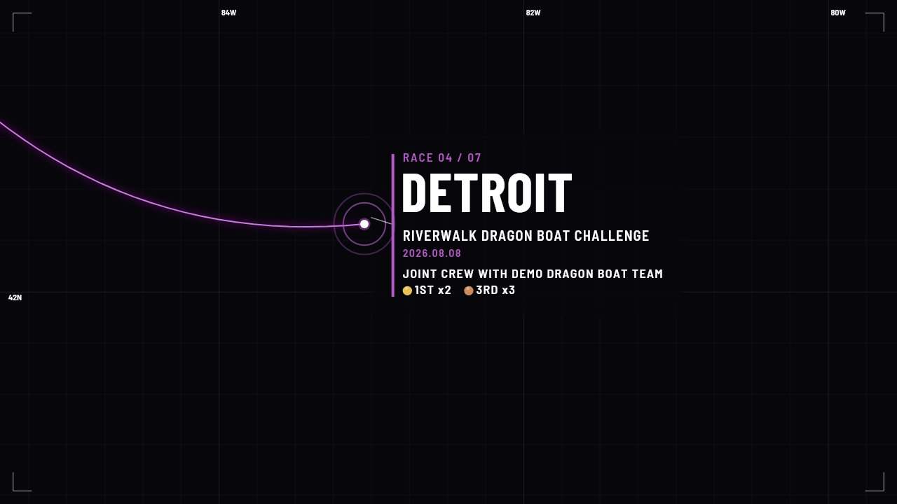

# Project format

A Waycine project is one JSON file, by convention named `*.waycine.json`
(UTF-8). The web app saves and opens these files ("Save project" and "Open
project", or drop a file on the page), `waycine init` writes one from a
preset, and you can write one by hand. This page describes the format,
schema version 1. Every setting, with its default and range, is listed in
[parameters.md](parameters.md).

## The smallest project

```json
{
  "$schema": "https://zhenyuanlu.github.io/waycine/schema/v1.json",
  "version": 1,
  "stops": [
    { "city": "Lisbon", "lat": 38.7223, "lon": -9.1393 },
    { "city": "Madrid", "lat": 40.4168, "lon": -3.7038 }
  ]
}
```

Everything you leave out takes its default: a file only needs to list what
differs. The web app writes files this way too (only the changed settings,
plus `version`, `meta` and `stops`).

`$schema` is optional. It points editors such as VS Code at the
[JSON Schema](https://zhenyuanlu.github.io/waycine/schema/v1.json) of the
format, so they can complete setting names and flag mistakes. The same
file is in this repository at `apps/web/public/schema/v1.json`.

## Top-level structure

| Key | What it holds | Settings |
| --- | --- | --- |
| `$schema` | Optional URL of the JSON Schema | |
| `version` | Schema version of the file: `1` | |
| `meta` | `name`: the project name; exported files are named after it | [Video](parameters.md#video) |
| `stops` | The stops, in video order (below) | [Stops](parameters.md#stops) |
| `text` | Title, subtitle, description, stop label and date formats; templates may use tokens | [Titles & text](parameters.md#titles--text) |
| `theme` | Colours, including the medal colours | [Look](parameters.md#look) |
| `fonts` | `display` and `body` fonts: family, source, size and width scale | [Look](parameters.md#look) |
| `timing` | Lengths of the intro, stops and finale; transition; animation timing | [Timing](parameters.md#timing) |
| `camera` | Zoom levels, easing | [Camera](parameters.md#camera) |
| `route` | Route line and glow | [Route](parameters.md#route) |
| `pins` | Pins, pulse rings, pin labels | [Pins](parameters.md#pins) |
| `card` | The stop card | [Stop card](parameters.md#stop-card) |
| `stats` | Finale statistics (below) | [Finale stats](parameters.md#finale-stats) |
| `graticule`, `hud` | Map grid, grid labels, corner marks | [Map grid & HUD](parameters.md#map-grid--hud) |
| `output` | Aspect, size, frame rate, quality, layout choice, export mode | [Video](parameters.md#video) |
| `layouts` | Geometry per layout profile: `landscape`, `portrait`, `square` (below) | [Layout](parameters.md#layout) |

### Units

Sizes and positions are in design units (Du): 1 Du is 1/1080 of the frame's
shorter side, so 1 Du is one pixel at 1080p and two at 2160p. A project
therefore looks the same at every resolution. Durations are in seconds;
the engine turns each one into `max(1, round(seconds x fps))` frames. Other
units are listed at the top of [parameters.md](parameters.md#how-to-read-this-page).

## Stops

```json
{
  "id": "lisbon",
  "city": "Lisbon",
  "lat": 38.7223,
  "lon": -9.1393,
  "event": "Trams, tiles and sunset viewpoints",
  "date": "2026-06-20",
  "endDate": "2026-06-23",
  "country": "PT"
}
```

| Field | Meaning |
| --- | --- |
| `city` | The place name on the card and the pin label (needed) |
| `lat`, `lon` | Position in degrees (needed). Latitude is limited to +-85.05 (the map projection); longitudes outside -180 to 180 are wrapped. A route that crosses the 180th meridian takes the short way |
| `id` | A stable id, unique in the project; generated as `stop-1`, `stop-2`, ... when missing |
| `event` | The line under the city |
| `date`, `endDate` | `YYYY-MM-DD`; with an end date the card shows a range |
| `dateText` | Free text shown instead of the formatted date |
| `partner` | An extra line on the card (a credit or a partner) |
| `region`, `regionCode`, `country` | Used by the regions and countries stats: `region` as shown (`MA`), `regionCode` as a key (`US-MA`), `country` as a two-letter code (`US`) |
| `results` | Result lines: `{ "medal": "gold", "text": "500M  6TH", "count": 1 }`. `medal` is `gold`, `silver`, `bronze`, `ring` (an outline medal) or `none`; `count` (1 to 5) is the number of medal dots on the pin label |
| `durationSec` | This stop's length in seconds, instead of `timing.stopSec` |
| `hidden` | `true` leaves the stop out of the video (no pin, route leg, card or stat) |



The card of stop 4 in the race season demo: the stop label (`text.kicker`,
"RACE 04 / 07"), then `city`, `event`, `date`, `partner` and two `results`.

A project holds at most 99 stops, and at least one must be visible. Text is
drawn exactly as typed, including repeated spaces; with `text.uppercase` (on
by default) it is drawn in capitals, except result lines.

## Text tokens

The title, subtitle, description and stop label (`text.kicker`) are
templates. Tokens in braces are replaced with numbers of the journey; nothing
else is evaluated.

| Token | Becomes |
| --- | --- |
| `{stops}` | Number of visible stops |
| `{regions}`, `{countries}` | Distinct regions and countries of the stops |
| `{months}`, `{days}` | Calendar months and days from the first date to the last (end) date |
| `{km}`, `{mi}` | Length of the route in kilometres or miles (great-circle distances between stops) |
| `{year}` | Year of the first stop with a date |
| `{n}`, `{total}` | In the stop label: this stop's number and the number of stops |

Three forms:

- `{km}` prints the number with thousands separators: `3,376`.
- `{n:02}` pads the number with zeros to the given width: `03`.
- `{stops|STOP|STOPS}` prints the number, a space, and the first word when the
  number is exactly 1, otherwise the second: `1 STOP`, `8 STOPS`.

Unknown names and malformed tokens are printed as they are. A known token
whose number cannot be computed (`{countries}` when no stop has a country,
`{months}` when no stop has a date) is left out together with one separator
next to it (`/`, `|` or `,`), and loading the project warns about it.

The demos show the result:

| Demo | Template | Drawn as |
| --- | --- | --- |
| Race season | subtitle `{stops\|RACE\|RACES}  /  {regions\|STATE\|STATES}` | `7 RACES  /  5 STATES` |
| Race season | stop label `RACE {n:02} / {total:02}` | `RACE 03 / 07` (third stop) |
| Road trip | subtitle `{days} DAYS  /  {regions\|STATE\|STATES}  /  {mi} MILES` | `11 DAYS  /  3 STATES  /  777 MILES` |
| World tour | title `World tour {year}` | `WORLD TOUR 2026` (capitals from `text.uppercase`) |
| Europe trip | subtitle `{stops\|CITY\|CITIES}  /  {countries\|COUNTRY\|COUNTRIES}  /  {km} KM` | `8 CITIES  /  7 COUNTRIES  /  3,376 KM` |
| Europe trip | stop label `City {n:02} / {total:02}` | `CITY 03 / 08` (capitals from `text.uppercase`) |

### Date formats

`text.cardDate` (default `YYYY.MM.DD`) and `text.pinDate` (default `MM.DD`;
empty hides the dates on the pins) are formats. `YYYY` is the year, `MMM` the
month as `JAN` to `DEC`, `MM` and `M` the month with and without a leading
zero, `DD` and `D` the day; anything else is copied. A stop with an
`endDate` shows `start + text.rangeSeparator + end` (default separator
`" - "`), for example `2026.06.20 - 2026.06.23`. Stops at the same place share
one pin, whose label joins their dates with `text.pinDateJoin`.

## Finale stats

`stats.items` lists the numbers of the finale, in order:

```json
"stats": {
  "items": [
    { "source": "stops", "label": "CITIES", "labelOne": "CITY" },
    { "source": "countries", "label": "COUNTRIES", "labelOne": "COUNTRY" },
    { "source": "km", "label": "KM" }
  ]
}
```

`source` is one of `stops`, `regions`, `countries`, `months`, `days`, `km`,
`mi` (computed as for the tokens above) or `custom`, which shows its own
`value` (text, for example `"12"` or `"3RD"`). `labelOne` replaces `label`
when the number is exactly 1. An item without a number (no data, or a custom
item without a value) is left out.

## Colours and themes

Colours are `#RRGGBB` (`#RGB` is read too). `theme.id` records which built-in
theme the colours came from (`orchid`, `midnight-cyan`, `ember`,
`mono`) or `custom`; it does not change any colour by itself, so a file that
uses a theme lists its colours, as the Europe preset does.

## Layout profiles

The engine has three layouts: `landscape` (wider than 1.2:1), `portrait`
(narrower than 0.83:1, which includes 4:5) and `square` (in between).
`output.layout` is `auto` (pick by shape) or one of the three. Each profile
has its own geometry under `layouts.<profile>`: overview framing, where the
stop pin sits, title, card, pin labels and stats. A file overrides only the
values it lists, for one profile only. The Europe preset, for example, frames
its overview lower in portrait:

```json
"layouts": {
  "portrait": {
    "fit": { "marginY": 1220, "offsetDu": [0, 170] }
  }
}
```

## Fonts

`fonts.display` (titles, cities, numbers) and `fonts.body` (the other texts)
use the bundled Barlow Condensed and Barlow Semi Condensed by default
(`"source": "bundled"`). A font uploaded in the web app is stored in that
browser only and is referenced with `"source": "local"`; on another device
the bundled font stands in for it. The CLI takes font files with `--font`.
`widthAdjust` stretches or narrows a font horizontally and `sizeAdjust`
scales it; 1 leaves the font as it is. A width set for one font does not
suit another, so reset it to 1 when you change the font.

## Loading and validation

Loading a project never fails outright. The loader (`validateProject` in the
library, used by the web app and the CLI):

1. reads `version` and upgrades older files (see below);
2. fills every missing setting with its default;
3. repairs what it can, with a warning each time: numbers outside their range
   are clamped, numbers written as text (`"12"`) and dates written as
   `2026.06.20` are converted, unknown options fall back to the default;
4. keeps settings it does not know, with a warning, so a file from a newer
   Waycine keeps them when saved again;
5. reports errors for what it cannot repair: a stop without a valid latitude
   and longitude is skipped, and a project needs at least one visible stop.

`waycine validate project.waycine.json` prints every issue (and exits with 1
when there is an error); the web app shows them when you open a file.

| Code | Level | Meaning |
| --- | --- | --- |
| `not-object` | error | The file is not a JSON object |
| `no-stops` | error | No visible stop |
| `invalid-stop` | error | A stop without a valid latitude and longitude; it is skipped |
| `bad-version` | warning | `version` is missing or not a whole number; read as version 1 |
| `newer-version` | warning | Made with a newer Waycine; unknown settings are kept but not used |
| `unknown-key` | warning | A setting this version does not know; kept but not used |
| `wrong-type` | warning | A value of the wrong kind; the default is used, or the value is dropped |
| `coerced` | warning | A value was converted (text to number, `2026.06.20` to `2026-06-20`, medal `qual` to `ring`) |
| `clamped` | warning | A number was out of range and was clamped |
| `invalid-enum` | warning | Not one of the allowed options; the default is used |
| `invalid-color` | warning | Not a colour; the default is used |
| `invalid-date` | warning | Not a calendar date; dropped |
| `missing-city` | warning | A stop without a name |
| `duplicate-id` | warning | Two stops share an id; the second is renamed |
| `too-many-stops` | warning | Only the first 99 stops are kept |
| `invalid-stat` | warning | A stat without a valid source, or a custom stat without a value |
| `token-no-data` | warning | A text token whose number cannot be computed; it is left out |

The JSON Schema is stricter than the loader: it flags unknown settings and
out-of-range values that the loader would repair.

## Versions and migration

`version` is a whole number; this page describes version 1, the first.

- A file without `version` is read as the current version, with a warning.
- A file from a newer Waycine (`version` higher than the app knows) is read
  as the current version with the warning "Made with a newer Waycine":
  settings this version knows are used, the others are kept.
- A file with an older version is upgraded one version at a time by the
  library's `migrateProject` before it is validated, and is saved in the
  current version.

New settings that keep existing videos unchanged when absent are added
without a new version. A change that renames, removes or changes the
meaning of a setting raises the version and comes with a migration step, a
new schema URL (`/schema/v2.json`) and a CHANGELOG entry.

## Share links

A share link carries the same compact JSON as a saved file, compressed
(deflate) and encoded (base64url) after `#p=` in the address. The part after
`#` is never sent to a server. Links longer than 65,536 characters, or that
unpack to more than 2 MB, are refused.

## Examples

The demos are complete, working projects, each for a different kind of
journey:

- [Europe trip](../packages/waycine/presets/europe-trip.waycine.json), the
  default: eight cities with date ranges and countries, the Midnight Cyan
  theme, the fly transition, 9:16 at 30 fps, and a portrait layout override.
- [Race season](../packages/waycine/presets/race-season.waycine.json): seven
  made-up races with results, every medal kind, medal counts and an extra
  line, regions, solid text, Flash to white, 16:9 at 29.97 fps.
- [Road trip](../packages/waycine/presets/road-trip.waycine.json): a loop
  that ends where it starts (one shared pin), miles and days, a description
  line, month-name dates, one longer stop, curves bent outward, the Ember
  theme, Dip to dark, 1:1 at 24 fps.
- [World tour](../packages/waycine/presets/world-tour.waycine.json): nine
  shows around the world, across the 180th meridian, with a `{year}` title,
  a date text, a stat with its own value, degree grid labels, its own
  colours and Flash to colour, 16:9 at 30 fps.
- [Day trip](../packages/waycine/presets/day-trip.waycine.json): one day in
  one place south of the equator, clock times as date text, one hidden stop,
  mixed-case text, no corner marks, the Mono theme, the fly transition, and
  its own framing and stats row for 4:5 at 25 fps.

Start from one with `waycine init --preset europe-trip -o trip.waycine.json`,
or with "Start from" in the web app.
